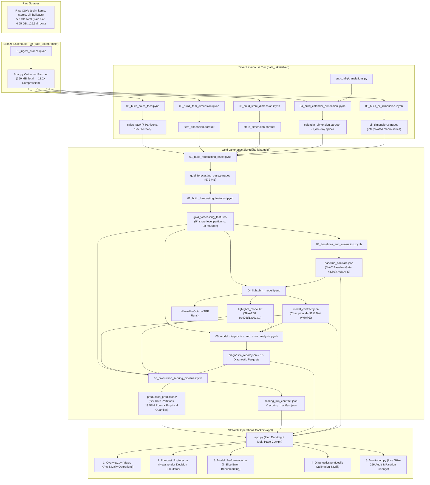

# 🛒 Enterprise Retail Demand Forecasting & Replenishment Optimization Platform

[](https://www.python.org/)
[](https://duckdb.org/)
[](https://lightgbm.readthedocs.io/)
[](https://streamlit.io/)
[](https://parquet.apache.org/)
[](https://mlflow.org/)
[](https://opensource.org/licenses/MIT)

An enterprise-grade **Medallion Data Lakehouse**, **Gradient Boosted Forecasting Engine**, and **Operations Research Decision Platform** modeled on the Corporación Favorita grocery supply chain (**54 physical stores**, **33 product families**, **3,500+ SKUs**, and **125.5M+ transactions**).

---

## 📑 Table of Contents

1. [Executive Summary &amp; Supply Chain Economics](#-executive-summary--supply-chain-economics)
2. [End-to-End System Architecture](#-end-to-end-system-architecture)
3. [Medallion Lakehouse Pipeline](#-medallion-lakehouse-pipeline)
4. [Machine Learning &amp; Governance Contracts](#-machine-learning--governance-contracts)
5. [Benchmark Evaluation &amp; Model Performance](#-benchmark-evaluation--model-performance)
6. [Operations Research: Newsvendor Decision Engine](#-operations-research-newsvendor-decision-engine)
7. [Streamlit Operations Cockpit](#-streamlit-operations-cockpit)
8. [Repository Directory Layout](#-repository-directory-layout)
9. [Quickstart &amp; Execution Guide](#-quickstart--execution-guide)
10. [Authors &amp; Attribution](#-authors--attribution)

---

## 🎯 Executive Summary & Supply Chain Economics

Traditional retail forecasting systems optimize symmetrically for statistical loss metrics such as **Mean Absolute Error (MAE)** or **Root Mean Squared Error (RMSE)**. In physical retail supply chains, this approach leads to sub-optimal replenishment decisions because real-world costs are inherently **asymmetric**:

* **Understocking (Stockouts):** Causes immediate lost gross margin, supplier penalties, customer attrition, and brand erosion.
* **Overstocking (Spoilage & Wastage):** Ties up working capital, incurs warehouse holding costs, and causes catastrophic 100% margin write-offs on perishable fresh goods (produce, dairy, meats).

```
                      ┌────────────────────────────────────────┐
                      │    DEMAND UNCERTAINTY REALIZATION      │
                      └───────────────────┬────────────────────┘
                                          │
                  ┌───────────────────────┴───────────────────────┐
                  ▼                                               ▼
     ┌─────────────────────────┐                     ┌─────────────────────────┐
     │  DEMAND > INVENTORY     │                     │  INVENTORY > DEMAND     │
     │      (Understock)       │                     │       (Overstock)       │
     ├─────────────────────────┤                     ├─────────────────────────┤
     │ • Lost Revenue & Margin │                     │ • Capital Lockup        │
     │ • Customer Dissatisfaction│                   │ • Holding & Storage Cost│
     │ • Brand Switching       │                     │ • Perishable Spoilage   │
     └─────────────────────────┘                     └─────────────────────────┘
```

This platform solves the asymmetry by combining **LightGBM gradient boosting** with the classic **Newsvendor Model** from Operations Research. The system transforms point forecasts and empirically calibrated prediction intervals into **financially optimal purchase order quantities ($Q^*$)** that maximize expected profit under custom unit costs and service levels.

---

## 🏗️ End-to-End System Architecture

The platform architecture spans four decoupled stages: **Ingestion & Lakehouse Transformation**, **Feature Store & Modeling**, **Diagnostics & Batch Scoring**, and **Read-Only Decision Serving**.



---

## 📦 Medallion Lakehouse Pipeline

The data pipeline adopts the **Medallion Architecture**, guaranteeing strict schema validation, type safety, and memory-safe transformations across three tiers:

### 🥉 Bronze Tier: Raw Ingestion & Compression

* **Notebook:** [01_ingest_bronze.ipynb](file:///d:/Demand_forecasting/inventory-lakehouse/notebooks/bronze/01_ingest_bronze.ipynb)
* **Ingestion Strategy:** Streamed batch reading via `pyarrow.csv.open_csv` with chunked block writes into Snappy-compressed Parquet.
* **Outcome:** Compresses raw 4.65 GB `train.csv` (125.5M rows) into 7 partition files totaling ~350 MB on disk (**13.2x storage compression ratio**), eliminating Python heap memory spikes.

### 🥈 Silver Tier: Star-Schema Dimensional Modeling

* [01_build_sales_fact.ipynb](file:///d:/Demand_forecasting/inventory-lakehouse/notebooks/silver/01_build_sales_fact.ipynb): Casts transaction types (`store_id`: `int16`, `sku_id`: `int32`, `unit_sales`: `float32`, `is_promotion`: `bool`), manages returns, and writes partitioned Parquet facts.
* [02_build_item_dimension.ipynb](file:///d:/Demand_forecasting/inventory-lakehouse/notebooks/silver/02_build_item_dimension.ipynb): Cleans 3,500+ SKU catalog, sets `sku_id` primary key, extracts English/Spanish category names via [translations.py](file:///d:/Demand_forecasting/inventory-lakehouse/src/config/translations.py), and derives `is_perishable`.
* [03_build_store_dimension.ipynb](file:///d:/Demand_forecasting/inventory-lakehouse/notebooks/silver/03_build_store_dimension.ipynb): Normalizes 54 retail stores across city, state, store type (`A`–`E`), and cluster assignments (`1`–`17`).
* [04_build_calendar_dimension.ipynb](file:///d:/Demand_forecasting/inventory-lakehouse/notebooks/silver/04_build_calendar_dimension.ipynb): Constructs a continuous 1,704-day **Date Spine** (`2013-01-01` to `2017-08-31`) and executes hierarchical geographic holiday resolution (`National` > `Regional` > `Local`).
* [05_build_oil_dimension.ipynb](file:///d:/Demand_forecasting/inventory-lakehouse/notebooks/silver/05_build_oil_dimension.ipynb): Ingests WTI crude oil price series, interpolates weekend/holiday gaps, and computes 7-day and 30-day moving averages (`oil_price_ma7`, `oil_price_ma30`).

### 🥇 Gold Tier: Feature Store, ML Models & Diagnostics

* [01_build_forecasting_base.ipynb](file:///d:/Demand_forecasting/inventory-lakehouse/notebooks/gold/01_build_forecasting_base.ipynb): Executes out-of-core DuckDB SQL star-joins, aligning decision time $D$ (`forecast_date`) with realization time $D+1$ (`target_date`, `target_unit_sales`) with **zero future target leakage**.
* [02_build_forecasting_features.ipynb](file:///d:/Demand_forecasting/inventory-lakehouse/notebooks/gold/02_build_forecasting_features.ipynb): Generates 28 time-series features across 54 store-batched partitions:
  * **Lags:** $t-1, t-7, t-14, t-28$
  * **Rolling Aggregations:** 7-day, 14-day, 28-day moving means and standard deviations.
  * **Intermittent Demand Indicators:** `zero_sales_count_7d`, `zero_sales_count_28d`.
  * **Calendar & Exogenous:** `target_day_of_week`, `target_month`, `target_is_weekend`, `target_is_holiday`, `on_promotion_today`, `on_promotion_tomorrow`, `oil_price`.
* [03_baselines_and_evaluation.ipynb](file:///d:/Demand_forecasting/inventory-lakehouse/notebooks/gold/03_baselines_and_evaluation.ipynb): Establishes statistical benchmarks and freezes the deployment gate in `baseline_contract.json`.
* [04_lightgbm_model.ipynb](file:///d:/Demand_forecasting/inventory-lakehouse/notebooks/gold/04_lightgbm_model.ipynb): Trains LightGBM with Optuna Bayesian optimization (10 TPE trials), MLflow run tracking, and baseline gate validation.
* [05_model_diagnostics_and_error_analysis.ipynb](file:///d:/Demand_forecasting/inventory-lakehouse/notebooks/gold/05_model_diagnostics_and_error_analysis.ipynb): Decomposes prediction residuals across 15 analytical dimensions, tests empirical decile calibration, monitors distribution shift, and validates production readiness in `diagnostic_report.json`.
* [06_production_scoring_pipeline.ipynb](file:///d:/Demand_forecasting/inventory-lakehouse/notebooks/gold/06_production_scoring_pipeline.ipynb): High-throughput batch inference scoring **19.57M predictions** across 227 date partitions with tier-calibrated empirical uncertainty bounds ($q_{10}, q_{90}$).

---

## 📜 Machine Learning & Governance Contracts

The repository adheres to strict MLOps contract boundaries. Each pipeline phase emits machine-readable JSON schemas preventing silent data leakage, parameter divergence, or unvalidated deployments:

| Contract File                           | Emitted By  | Core Role & Contents                                                                                                                                                                                        |
| :-------------------------------------- | :---------- | :---------------------------------------------------------------------------------------------------------------------------------------------------------------------------------------------------------- |
| **`baseline_contract.json`**    | Notebook 03 | Defines time-series split boundaries (`Train` $\le$ 2016-08-31, `Val` 2016-09-01–2016-12-31, `Test` 2017-01-01–2017-08-15) and locks the promotion gate (Validation WMAPE threshold: `0.4831`). |
| **`model_contract.json`**       | Notebook 04 | Full lineage contract for champion booster: MLflow run IDs, optimal hyperparameters, 24-feature schema, categorical mappings, and test set performance proof.                                               |
| **`diagnostic_report.json`**    | Notebook 05 | Records post-training diagnostic findings, empirical volume tier cutoffs ($q_{33}=2.79, q_{66}=6.96$), zero blocking issues, and verified model SHA-256 checksum.                                         |
| **`scoring_run_contract.json`** | Notebook 06 | Manifests production batch scoring parameters, 227 date partitions, 19.57M rows scored, quality gate verifications, and empirical quantiles by volume tier.                                                 |
| **`app_contract.json`**         | App Core    | Declares presentation-layer governance: strict read-only operation, forbidding UI retraining or model mutations.                                                                                            |

---

## 📊 Benchmark Evaluation & Model Performance

### Quantitative Comparison: Baselines vs. Champion LightGBM

All models are evaluated on the exact same leak-safe temporal splits:

* **Train Split:** 2013-01-01 to 2016-08-31 (1,338 days)
* **Validation Split:** 2016-09-01 to 2016-12-31 (122 days) — Used exclusively for model selection and Optuna tuning.
* **Test Holdout Split:** 2017-01-01 to 2017-08-15 (227 days) — Evaluated exactly once.

$$
\text{WMAPE} = \frac{\sum_{i=1}^N |y_i - \hat{y}_i|}{\sum_{i=1}^N y_i}, \quad \text{MAE} = \frac{1}{N}\sum_{i=1}^N |y_i - \hat{y}_i|
$$

| Model Architecture                             | Validation WMAPE | Validation MAE |    Test WMAPE    |    Test MAE    |          Baseline Beat Status          |
| :--------------------------------------------- | :--------------: | :-------------: | :--------------: | :-------------: | :------------------------------------: |
| **Naive Last-Known ($t$)**             |      63.84%      |      6.014      |      63.78%      |      5.815      |                   —                   |
| **Naive Same-Day-Last-Week ($t-6$)**   |      58.12%      |      5.476      |      58.45%      |      5.328      |                   —                   |
| **Moving Average 7-Day (MA-7 Baseline)** |      48.31%      |      4.552      |      48.59%      |      4.430      |             Benchmark Gate             |
| **LightGBM Champion (Trial #7)**         | **43.75%** | **4.104** | **44.92%** | **3.898** | **✅ PASSED (+7.56% Rel. Gain)** |

> **Key Win:** The LightGBM model reduced test holdout **MAE by 12.01%** and **WMAPE by 7.56%** relative to the best rolling statistical baseline, translating to millions of units in reduced forecast variance.

### Optimal Hyperparameters (Optuna TPE Tuning)

```json
{
  "learning_rate": 0.02693,
  "num_leaves": 127,
  "min_child_samples": 250,
  "colsample_bytree": 0.7712,
  "subsample": 0.7735,
  "reg_alpha": 0.00171,
  "reg_lambda": 0.03859,
  "n_estimators": 496,
  "objective": "regression",
  "random_state": 42
}
```

---

## 📐 Operations Research: Newsvendor Decision Engine

The platform bridges the gap between machine learning predictions and replenishment decisions via the classic **Newsvendor Model**:

```
                       Cost / Loss Landscape
           ▲
           │                    Optimal Order Q*
    Cost   │                         │
           │        Overstock Cost   │   Understock Cost
           │        Co * (Q - D)+    │   Cu * (D - Q)+
           │              \          │          /
           │               \         │         /
           │                \        ▼        /
           │                 \───────────────/
           │                  Total Expected
           │                       Cost
           └────────────────────────────────────────► Order Quantity (Q)
```

### 1. Critical Fractile ($SL^*$)

Given unit selling price ($P$), unit purchase cost ($C$), and salvage value for unsold goods ($V$):

* **Cost of Understocking ($C_u$):** $C_u = P - C + \text{Penalty}$ (Lost margin per unit)
* **Cost of Overstocking ($C_o$):** $C_o = C - V$ (Net inventory loss per unit)

The mathematically optimal service level (critical fractile) is:

$$
SL^* = \frac{C_u}{C_u + C_o}
$$

### 2. Calibrated Empirical Order Sizing ($Q^*$)

Rather than assuming uncalibrated Gaussian errors ($z \cdot \sigma$), the platform computes order sizing and safety stock using **validation-derived empirical residual quantiles** ($q_{10}, q_{90}$) segmented by demand tier:

| Demand Volume Tier | Rolling 28d Mean Range | Empirical Residual$q_{10}$ | Empirical Residual$q_{90}$ | Expected MAE |            |
| :----------------- | :--------------------: | :---------------------------------------------------------: | :----------: | :--------: |
| **1_Low**    |   $\le 2.79$ units   |                         -2.11 units                         | +2.33 units | 1.64 units |
| **2_Mid**    | $2.79 - 6.96$ units |                         -3.96 units                         | +4.38 units | 2.93 units |
| **3_High**   |    $> 6.96$ units    |                        -10.79 units                        | +10.37 units | 8.26 units |

$$
\text{Safety Stock } (SS) = \text{Empirical Quantile}(SL^*, \text{Tier}), \quad Q^* = \max\left(0, \hat{y} + SS\right)
$$

---

## 🖥️ Streamlit Operations Cockpit

The web interface is a **governed, read-only supply chain cockpit** built in Streamlit and styled with a custom **Zinc Dark/Light Design System** and vector SVG icons:

```
inventory-lakehouse/app/
├── app.py                     # Entry point & sidebar navigation router
├── pages/
│   ├── 1_Overview.py          # Executive KPI cards & daily replenishment snapshot
│   ├── 2_Forecast_Explorer.py # Interactive SKU series & Newsvendor sizing simulator
│   ├── 3_Model_Performance.py # 7-dimensional slice-level error benchmarking
│   ├── 4_Diagnostics.py       # Feature gain/split, calibration deciles & drift
│   └── 5_Monitoring.py        # Live SHA-256 verification & partition audit
└── utils/
    ├── artifacts.py           # JSON contract loaders & validator
    ├── data_loader.py         # Out-of-core DuckDB Parquet query engine
    ├── icons.py               # Resolution-independent vector SVG icons & badges
    ├── plots.py               # Zinc-themed Plotly charts & uncertainty bands
    ├── style.py               # Custom CSS design tokens & card containers
    └── validators.py          # Data contract integrity assertion gates
```

### Module Overview:

1. **Executive Overview ([1_Overview.py](file:///d:/Demand_forecasting/inventory-lakehouse/app/pages/1_Overview.py)):**
   * Top-level summary cards: Model Test WMAPE (44.92%), Baseline MA-7 (48.59%), Test MAE (3.90 units), Active Store-SKUs (84,659).
   * Daily operations snapshot and real-time inventory demand volume distributions.
2. **Forecast Explorer ([2_Forecast_Explorer.py](file:///d:/Demand_forecasting/inventory-lakehouse/app/pages/2_Forecast_Explorer.py)):**
   * Store and SKU selector across 54 stores and 33 families.
   * Full historical replay curve comparing Ground Truth vs. Predicted Demand with calibrated $80\%$ uncertainty intervals.
   * **Interactive Newsvendor Simulator:** Live sliders for Unit Price ($P$), Cost ($C$), and Salvage Value ($V$) dynamically computing Critical Fractile ($SL^*$), Safety Stock ($SS$), and Recommended Order Quantity ($Q^*$).
3. **Model Performance ([3_Model_Performance.py](file:///d:/Demand_forecasting/inventory-lakehouse/app/pages/3_Model_Performance.py)):**
   * 7-dimensional slice evaluation: Store, Product Family, Demand Volume Tier, Day of Week, Holiday Impact, Promotion Status, and Perishability.
4. **Model Diagnostics & Risk ([4_Diagnostics.py](file:///d:/Demand_forecasting/inventory-lakehouse/app/pages/4_Diagnostics.py)):**
   * Feature split and gain importance plots (identifying `rolling_mean_7`, `lag_1`, and `on_promotion_tomorrow` as top drivers).
   * 1:1 Empirical Calibration Decile curves demonstrating volume alignment.
   * Kolmogorov-Smirnov distribution shift analysis across features.
5. **MLOps Monitoring & Governance ([5_Monitoring.py](file:///d:/Demand_forecasting/inventory-lakehouse/app/pages/5_Monitoring.py)):**
   * Complete 227-partition dataset audit (19,571,966 rows scored).
   * Live SHA-256 cryptographic verification of the active booster artifact (`ea408d13e01a...`).
   * Interactive contract inspector for all upstream governance files.

---

## 📁 Repository Directory Layout

```
inventory-lakehouse/
├── README.md                                # This document
├── requirements.txt                         # Application & pipeline dependencies
│
├── app/                                     # Streamlit Operations Cockpit
│   ├── app.py                               # Web application main entry point
│   ├── pages/                               # Multi-page application modules
│   │   ├── 1_Overview.py
│   │   ├── 2_Forecast_Explorer.py
│   │   ├── 3_Model_Performance.py
│   │   ├── 4_Diagnostics.py
│   │   └── 5_Monitoring.py
│   └── utils/                               # UI styles, vector icons, DuckDB loaders
│       ├── artifacts.py
│       ├── data_loader.py
│       ├── icons.py
│       ├── plots.py
│       ├── style.py
│       └── validators.py
│
├── data_lake/                               # Parquet Medallion Storage Layer
│   ├── bronze/                              # Raw compressed Parquet tables
│   ├── silver/                              # Clean facts & normalized dimensions
│   │   ├── sales_fact/                      # 125.5M rows (7 partition files)
│   │   ├── item_dimension.parquet
│   │   ├── store_dimension.parquet
│   │   ├── calendar_dimension.parquet
│   │   └── oil_dimension.parquet
│   └── gold/                                # Analytical bases, feature store & predictions
│       ├── app_contract.json
│       ├── gold_forecasting_base.parquet    # Unified base table (572 MB)
│       ├── gold_forecasting_features/       # 54 store partitions (store_id=*.parquet)
│       ├── forecasting_baseline_results/    # Baseline metrics & baseline_contract.json
│       ├── lightgbm_results/                # lightgbm_model.txt & model_contract.json
│       ├── lightgbm_diagnostics/            # 15 diagnostic parquets & diagnostic_report.json
│       └── production_predictions/          # 227 date partitions & scoring_run_contract.json
│
├── notebooks/                               # Jupyter Medallion Development Pipelines
│   ├── bronze/
│   │   └── 01_ingest_bronze.ipynb           # PyArrow streaming ingestion
│   ├── silver/
│   │   ├── 01_build_sales_fact.ipynb
│   │   ├── 02_build_item_dimension.ipynb
│   │   ├── 03_build_store_dimension.ipynb
│   │   ├── 04_build_calendar_dimension.ipynb
│   │   └── 05_build_oil_dimension.ipynb
│   └── gold/
│       ├── 01_analysing_data.ipynb          # Exploratory data analysis
│       ├── 01_build_forecasting_base.ipynb  # Zero-leakage base alignment
│       ├── 02_build_forecasting_features.ipynb # 28 engineered features
│       ├── 03_baselines_and_evaluation.ipynb # MA-7 baseline & gating contract
│       ├── 04_lightgbm_model.ipynb          # Optuna + LightGBM + MLflow
│       ├── 05_model_diagnostics_and_error_analysis.ipynb # 15-slice diagnostics
│       └── 06_production_scoring_pipeline.ipynb # 19.57M row out-of-core batch scoring
│
└── src/                                     # Centralized Python Configurations
    └── config/
        └── translations.py                  # Bilingual English/Spanish regex engine
```

---

## 🚀 Quickstart & Execution Guide

### 1. Environment Setup

Clone the repository and install required Python packages:

```bash
# Clone repository
git clone https://github.com/ranathungaWK/Inventory-Optimizer.git
cd Inventory-Optimizer/inventory-lakehouse

# Create and activate Python virtual environment
python -m venv .venv
source .venv/bin/activate  # On Windows: .venv\Scripts\activate

# Install dependencies
pip install -r requirements.txt
```

### 2. Launch the Streamlit Web Application

Launch the operations cockpit locally:

```bash
streamlit run app/app.py
```

The application will launch in your default browser at `http://localhost:8501`.

### 3. Launching MLflow Experiment Tracking UI

Inspect Optuna Bayesian hyperparameter optimization trials, metric curves, and run artifacts:

```bash
mlflow ui --backend-store-uri sqlite:///notebooks/gold/mlflow.db
```

Navigate to `http://127.0.0.1:5000` to view the `demand_forecasting_lightgbm` experiment and trial parameters.

### 4. Reproducing the End-to-End Pipeline

To execute the data lakehouse and ML pipeline from scratch:

1. **Ingest Bronze:** Execute `notebooks/bronze/01_ingest_bronze.ipynb`.
2. **Build Silver Dimensions:** Execute `notebooks/silver/01_build_sales_fact.ipynb` through `05_build_oil_dimension.ipynb`.
3. **Build Gold Base & Features:** Execute `notebooks/gold/01_build_forecasting_base.ipynb` and `02_build_forecasting_features.ipynb`.
4. **Evaluate Baselines:** Execute `notebooks/gold/03_baselines_and_evaluation.ipynb` to establish `baseline_contract.json`.
5. **Train LightGBM:** Execute `notebooks/gold/04_lightgbm_model.ipynb` to run Optuna tuning and serialize `lightgbm_model.txt`.
6. **Run Error Diagnostics:** Execute `notebooks/gold/05_model_diagnostics_and_error_analysis.ipynb` to generate `diagnostic_report.json`.
7. **Run Batch Scoring:** Execute `notebooks/gold/06_production_scoring_pipeline.ipynb` to score 19.57M holdout predictions and compute empirical quantiles.

---

## 👥 Authors & Attribution

* **Kalindu Ranathunga** — *Lead Data Scientist & Supply Chain Systems Architect* — [GitHub Profile](https://github.com/ranathungaWK)
* **Dataset:** Corporación Favorita Grocery Sales (Kaggle Retail Forecasting Challenge)

---

<p align="center">
  <b>Enterprise Inventory Optimizer Platform</b> • Built with DuckDB, LightGBM, Parquet, and Streamlit
</p>
